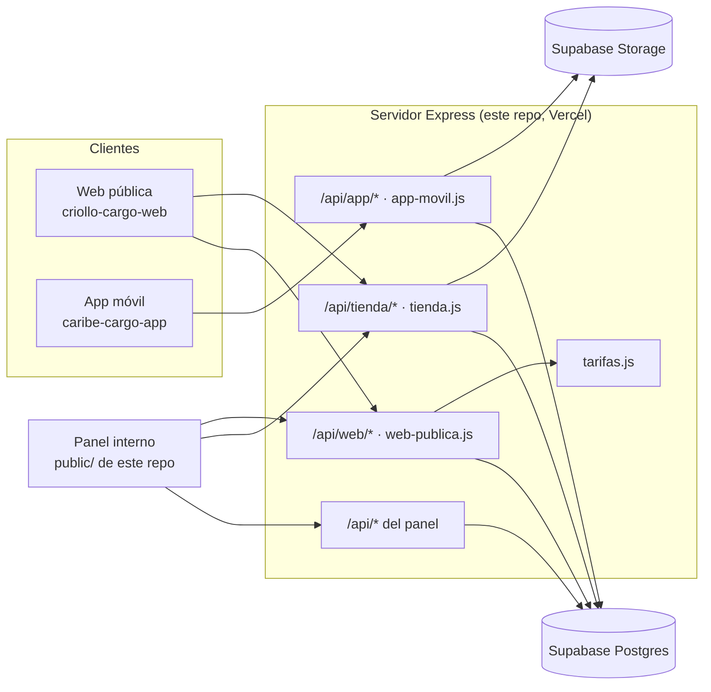

# Arquitectura de la web de Criollo Cargo

Página pública de Criollo Cargo según el diseño `Diseños/Criollo Cargo Web.html`: inicio, tablero de zarpes,
rastreo, cotizador, preguntas, tienda en preventa (catálogo, ficha, carrito) y contacto por WhatsApp.

## Principio: un solo sistema, tres caras

La web, la app y el panel usan **el mismo servidor y la misma base**. Por eso:

- El tablero de zarpes muestra los contenedores reales del panel, con la ocupación calculada de sus etiquetas.
- El rastreo público consulta las mismas etiquetas y contenedores que ve el equipo.
- Cada producto de la tienda viaja en un contenedor del panel: su fecha de llegada es la del contenedor.
- El cotizador usa `tarifas.js`, la misma tabla de la calculadora del panel.
- Las solicitudes de la web y los pedidos de la tienda llegan al panel.

El navegador **nunca** habla con la base: todas las tablas tienen RLS y sin permisos para `anon`/`authenticated`.
Solo el servidor (con la clave secreta) lee y escribe.

## Decisiones

| Tema | Decisión | Motivo |
|---|---|---|
| Backend | Módulos nuevos en este servidor (`web-publica.js`, `tienda.js`, `tarifas.js`) | Mismos datos que el panel sin sincronizar nada; un solo despliegue en Vercel. |
| Frontend | Proyecto aparte `criollo-cargo-web` con **Next.js** en Vercel (próxima fase) | La tienda necesita SEO (fichas indexables) y páginas rápidas; el panel no lo necesita. |
| Pagos | **Manual** (Pago Móvil, Zelle, transferencia, Binance, efectivo). El cliente reporta la referencia y el panel confirma | Es como se cobra hoy en Venezuela; una pasarela se puede sumar después sin cambiar el modelo. |
| Cupo | Se **reserva al crear el pedido** (descuento atómico) y se devuelve si se cancela o vence (`TIENDA_HORAS_RESERVA`, 48 h) | Es preventa por contenedor: el cupo es limitado y no se puede vender dos veces. |
| Vencimientos | Revisión «perezosa» al leer o escribir la tienda (máx. una vez por minuto) | Vercel no mantiene procesos; no hace falta un cron. |
| Precios | Siempre los calcula el servidor | El navegador solo manda variante y cantidad. |
| Cuenta del comprador | **Sin registro**: el pedido se consulta con número + token (se entrega una sola vez) | Menos fricción; el cliente de carga ya tiene la app móvil. Se puede enlazar con `clientes` desde el panel (`cliente_id`). |
| Opiniones y estrellas | **No** se muestran hasta tener opiniones reales | El diseño trae calificaciones de ejemplo; publicarlas inventadas sería engañoso. |
| Rastreo público | Solo etapa, tipo de carga y fechas; nunca datos del cliente | Los números de etiqueta son fáciles de adivinar. Con límite de consultas por IP. |

## Modelo de datos (nuevas tablas)

Migración `supabase/migrations/20261103000000_web_tienda.sql` (el servidor también las crea al arrancar).

- `contenedores` + `publicar_web`, `fecha_cierre`, `capacidad_cbm` (68 por defecto), `ruta`.
- `web_solicitudes` — «Reservar espacio» (con la cotización recalculada en el servidor), contacto y «avísame» de la tienda.
- `tienda_categorias` — Ferretería, Electro, Hogar, Autopartes…
- `tienda_productos` — nombre, slug, categoría, origen, descripción y especificaciones (listas JSON), precio, precio anterior,
  nombre de la variante («Color», «Kit»…), **contenedor**, orden, publicado.
- `tienda_variantes` — nombre, SKU, **cupo** (unidades que caben en ese contenedor), precio propio opcional.
- `tienda_imagenes` — fotos en Storage (bucket privado `tienda`), servidas por el servidor.
- `tienda_destinos` — retiro en Valencia, Caracas, Maracaibo… con costo y días extra.
- `tienda_pedidos` y `tienda_pedido_items` — datos de contacto, destino, montos, método y referencia de pago, estado,
  vencimiento de la reserva, cliente enlazado; las líneas guardan nombre, variante y precio del momento.

Estados del pedido: `pendiente_pago → pago_reportado → pagado → en_camino → entregado`, más `cancelado` y `vencido`
(estos dos devuelven el cupo). El panel solo puede hacer las transiciones permitidas.

## API

### Pública (sin sesión)

| Ruta | Para qué sección del diseño |
|---|---|
| `GET /api/web/zarpes` | Cinta y tablero de zarpes: contenedor, ruta, cierre, llegada, ocupación %, estado (Abierto, Cierra pronto, Lleno, En tránsito…) |
| `GET /api/web/rastreo/:codigo` | Rastreo por etiqueta o contenedor: etapa 0–4 (Recepción, Consolidado, Zarpe, Altamar, Entrega) |
| `GET /api/web/tarifas` · `POST /api/web/cotizar` | Cotizador (mismo cálculo en el navegador y en el servidor) |
| `POST /api/web/solicitudes` | «Reservar espacio», contacto y «avísame» (`tipo`: `reserva`, `contacto`, `aviso_producto`; campo trampa `sitioWeb`) |
| `GET /api/tienda/catalogo` | Tienda e inicio: categorías con conteo y tarjetas (precio, foto, contenedor, llegada, agotado) |
| `GET /api/tienda/productos/:slug` | Ficha: variantes disponibles, fotos, descripción, especificaciones y «En el mismo contenedor» |
| `GET /api/tienda/destinos` | Selector de entrega |
| `GET /api/tienda/imagenes/:id` | Fotos de productos publicados |
| `POST /api/tienda/pedidos` | «Pagar y reservar cupo»: crea el pedido y devuelve `numero`, `token`, total, vencimiento e instrucciones de pago |
| `GET /api/tienda/pedidos/:numero` | Estado del pedido (cabecera `X-Pedido-Token`) |
| `POST /api/tienda/pedidos/:numero/pago` | El cliente reporta la referencia de su pago |

### Panel (solo administrador)

`PUT /api/contenedores/:id/web` · `GET|PUT /api/web/solicitudes` · `GET|POST|PUT /api/tienda/admin/productos` ·
`POST /api/tienda/admin/productos/:id/imagenes` · `GET|DELETE /api/tienda/admin/imagenes/:id` ·
`GET|POST|PUT /api/tienda/admin/categorias` · `PUT /api/tienda/admin/destinos` · `GET /api/tienda/admin/pedidos` ·
`PUT /api/tienda/admin/pedidos/:id/estado`.

## Seguridad

- Límites por IP: formularios y pedidos (10 cada 15 min), rastreo y consulta de pedidos (30 por minuto).
- Validación de todo lo que entra; fotos verificadas por sus bytes; la API no revela el cupo exacto ni datos de clientes.
- Token de pedido aleatorio, guardado como hash y comparado en tiempo constante.
- CORS: `CORS_ORIGIN` debe incluir el dominio de la web (por ejemplo `https://criollocargo.com`).

## Variables de entorno nuevas

| Variable | Para qué |
|---|---|
| `TIENDA_INSTRUCCIONES_PAGO` | Texto con los datos de pago que se muestran al crear el pedido (si falta: «Tu asesora te escribirá…»). |
| `TIENDA_HORAS_RESERVA` | Horas que se guarda el cupo sin pago reportado (48). |
| `SUPABASE_BUCKET_TIENDA` | Bucket de fotos de productos (`tienda`). |
| `CORS_ORIGIN` | Añadir el dominio de la web. |

## Fases

1. **Base de la arquitectura (hecha):** esquema, migración, API pública y del panel, tarifas compartidas, pruebas.
2. **Panel:** pantallas para publicar contenedores en la web, productos y fotos, pedidos y solicitudes; pasar la
   calculadora del panel a `/api/web/tarifas` para que nunca se separen.
3. **Web (`criollo-cargo-web`):** Next.js con las secciones del diseño: inicio, zarpes, rastreo, cotizador, preguntas,
   tienda, ficha, carrito (en el navegador) y seguimiento del pedido. Dominio y SEO.
4. **Después:** avisos por WhatsApp o correo al cambiar el pedido, enlazar pedido pagado con cliente y etiqueta,
   pasarela de pago si se decide, opiniones reales.

## Pendiente de decidir

- Datos de pago reales (cuentas, teléfono de Pago Móvil, correo de Zelle) para `TIENDA_INSTRUCCIONES_PAGO`.
- Dominio de la web y del panel.
- Tarifas terrestres: el diseño y el panel difieren en algunos estados (el panel no tiene Carabobo ni Nueva Esparta y
  tiene «Oriente»). `tarifas.js` usa la tabla del diseño; hay que confirmarla.
- Contenido de las preguntas frecuentes y textos legales (términos de la preventa, devoluciones).
